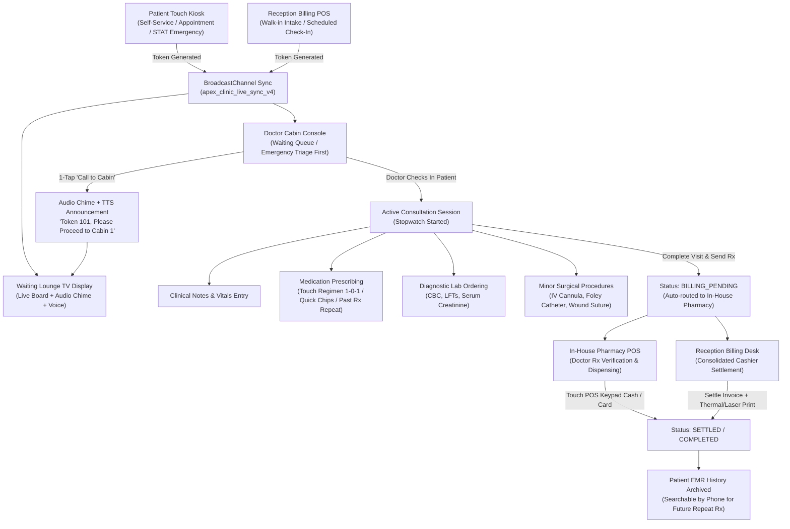
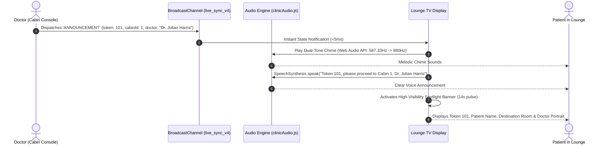
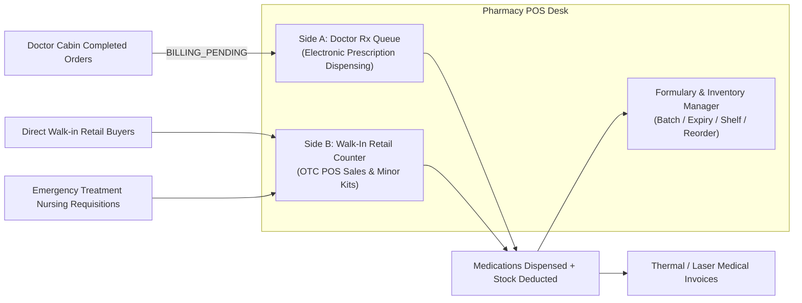
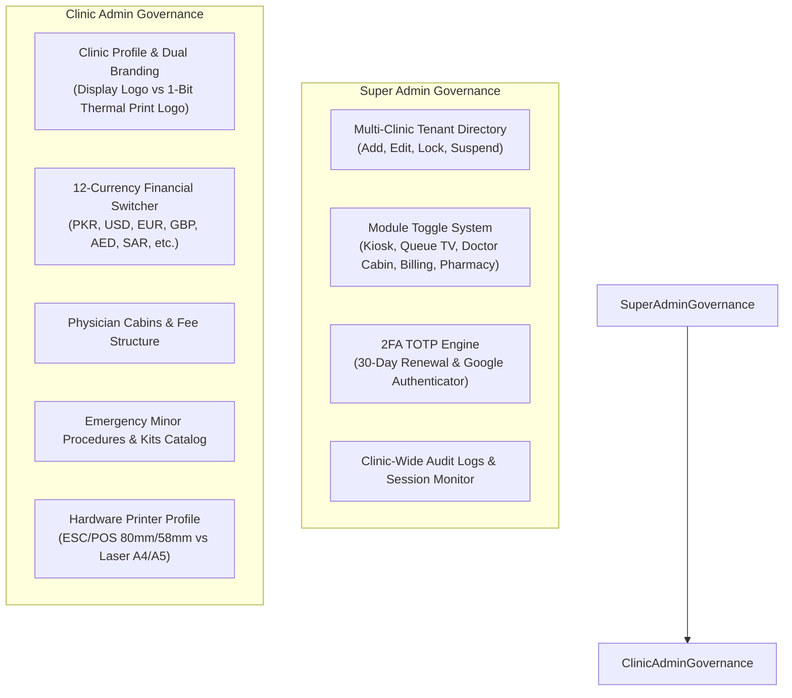

# Apex Clinic Healthcare OS — Clinical Workstations & End-to-End System Workflow Guide

> [!NOTE]
> **System Architecture**: Apex Clinic Healthcare OS is an enterprise, multi-tenant clinical operating system designed for modern multi-specialty clinics and diagnostic centers. All workstations communicate in real time (< 5ms latency) via browser `BroadcastChannel` (`apex_clinic_live_sync_v4`), ensuring zero-latency coordination between self-service touch kiosks, waiting lounge digital signage, physician cabins, in-house pharmacy counters, cashier billing desks, and administrative governance consoles.

---

## Table of Contents
1. [End-to-End Clinical Lifecycle Map](#1-end-to-end-clinical-lifecycle-map)
2. [Doctor Cabin Workstation Console (`DoctorCabinConsole.jsx`)](#2-doctor-cabin-workstation-console)
3. [TV Lounge Queue Display & Audio Calling Engine (`CabinQueueDisplay.jsx`)](#3-tv-lounge-queue-display--audio-calling-engine)
4. [In-House Pharmacy POS Desk (`InhousePharmacyDesk.jsx`)](#4-in-house-pharmacy-pos-desk)
5. [Reception & Cashier Billing POS Desk (`BillingPharmacyPOS.jsx`)](#5-reception--cashier-billing-pos-desk)
6. [Multi-Tenant Administration & Governance (`SuperAdminDashboard.jsx` & `AdminDashboard.jsx`)](#6-multi-tenant-administration--governance)
7. [Sub-System Data Synchronization & Event Architecture](#7-sub-system-data-synchronization--event-architecture)
8. [Hardware & Print Engine Integration Standards](#8-hardware--print-engine-integration-standards)

---

## 1. End-to-End Clinical Lifecycle Map

The diagram below illustrates how a patient progresses through the Apex Clinic ecosystem, from arrival at the kiosk or reception desk, to doctor examination, pharmacy dispensing, billing settlement, and electronic medical record (EMR) archiving.

---

## 2. Doctor Cabin Workstation Console

The **Doctor Cabin Workstation Console** (`DoctorCabinConsole.jsx`) serves as the primary clinical command center for attending physicians. It is built to minimize typing and screen-switch fatigue through intelligent one-tap action chips, automated regimen formatters, and integrated EMR history lookups.

### 2.1 Workspace Overview & Layout Structure
The console is divided into three functional operational zones:
1. **Clinical KPI & Shift Velocity Bar**: Real-time throughput metrics (Patients seen today, weekly, monthly; active waiting queue count; emergency triage count; prescriptions issued; diagnostic tests requested; minor procedures performed; average consultation duration).
2. **Patient Queue & Intake Hub**: Dynamic triage queue with immediate visual highlighting for STAT emergency admissions, toggleable between single-cabin view (`CABIN`) and clinic-wide intake view (`CLINIC`).
3. **Active Consultation Desk**:
   - **Hero Patient Banner**: Large token callout, demographic badge, triage vital signs badge (with inline quick-edit for temperature and vitals).
   - **Consultation Stopwatch**: Live mm:ss timer tracking patient face-to-face duration.
   - **Multi-Tab Clinical Pad**:
     - `PATIENT_SCREEN`: Patient overview, triage vitals, symptoms, registered complaints.
     - `PREVIOUS_PRESCRIPTION`: Historical encounter viewer matching patient phone number with one-tap repeat functionality.
     - `WRITE_PRESCRIPTION`: Full electronic prescription writing and diagnostic test requisition workspace.

### 2.2 Detailed Clinical Workflows

#### A. Patient Intake & Room Calling
1. **Waiting Queue Ingestion**: Patients registered via the Kiosk or Reception Desk appear in the cabin queue instantly. Emergency patients (marked with `isEmergency: true`) automatically float to the top of the queue with a red pulsating badge regardless of arrival time.
2. **Calling the Patient**:
   - The physician taps **"Call to Cabin"** (`handleCallNext`).
   - The system triggers a browser haptic pulse (`clinicAudio.triggerHaptic(30)`).
   - A `BroadcastChannel` event `ANNOUNCEMENT` is dispatched clinic-wide.
   - The TV Lounge Display sounds a two-tone melodic chime followed by high-definition text-to-speech vocal announcement.
   - The patient status transitions from `WAITING` to `CALLED`, and an elapsed timer (`calledTimer`) begins counting down.
3. **No-Show / Return Token**:
   - If a called patient fails to arrive, the doctor can tap **"Return Token"**.
   - A modal allows selecting the clinical reason (*Patient No-Show*, *Patient Left Facility*, *Duplicate Token*, *Reassigned to Another Cabin*).
   - The token status is updated to `RETURNED`, freeing the cabin immediately for the next patient.
4. **Session Check-In**:
   - When the patient enters the room, the doctor taps **"Check-In Patient"** (`handleCheckInPatient`).
   - Status updates to `IN_CONSULTATION`.
   - The consultation stopwatch initiates (`inConsultationPatient.consultationStartTime = Date.now()`).

#### B. Electronic Prescribing & Regimen Builder
- **1-Tap Quick-Add Routine Medications**: Pre-configured rapid prescription chips for high-frequency clinical items (e.g., *Panadol 500mg*, *Augmentin 625mg*, *Cranmax Sachet*, *Brufen 400mg*, *Flagyl 400mg*). Tapping a chip immediately attaches the medication to the patient's record with standard pre-filled dosing (`1-0-1`, `After Meals (PC)`, `5 Days`).
- **Touch-Screen Standard Dosage Customizer**:
  - Tapping on any prescribed medication opens a 5-step touch customizer:
    1. **Dosage Regimen**: `1-0-1` (BD), `1-1-1` (TDS), `1-0-0` (OD Morning), `0-0-1` (OD Night), `1-1-1-1` (QID), `PRN` (As Needed), `STAT` (Immediate).
    2. **Meal Timing**: `After Meals (PC)`, `Before Meals (AC)`, `With Meals`, `Bedtime (HS)`, `Empty Stomach`.
    3. **Duration**: `3 Days`, `5 Days`, `7 Days`, `10 Days`, `14 Days`, `1 Month`, `Continuous`.
    4. **Dispense Form**: `Tablet`, `Capsule`, `Syrup`, `Sachet`, `Injection`, `Ointment`, `Drop`.
    5. **Special Instructions**: Pre-compiled clinical directives (e.g., *"Take with a full glass of water. Complete full course even if symptoms subside"*).
- **1-Tap Repeat Previous Prescription**:
  - The EMR phone lookup automatically surfaces past visit records for returning patients.
  - Tapping **"Repeat Past Prescription"** (`handleRepeatPastRx`) copies all medications, regimens, and dosages into the current active session in a single click, with celebratory visual feedback.

#### C. Diagnostic Lab Requisitions
- Direct ordering of clinical pathology and diagnostic tests (CBC, Blood Sugar Fasting/Random, Liver Function Tests, Serum Creatinine, Urine Detailed Examination, Lipid Profile, Chest X-Ray).
- Zero billing friction: Doctor requisitions are purely clinical orders. Financial billing is deferred to the In-House Pharmacy or Cashier Desk upon checkout.

#### D. Minor Surgical & Emergency Procedure Suite
-Attending doctors can execute and record in-cabin minor procedures (e.g., *Peripheral IV Cannula Insertion 20G/22G*, *Foley Catheterization 16Fr*, *Wound Debridement & Crepe Bandaging*, *Inhalation Nebulization*, *Stat IM/IV Analgesic Injections*, *Minor Laceration Suturing*).
- Selecting a procedure automatically logs:
  - Exact anatomical site (e.g., *Right Forearm*, *Left Antecubital Fossa*).
  - Attending physician and nursing staff identification.
  - Standard consumable kit allocation (syringes, sterile gauze, antiseptic swabs, micropore tape).
  - Procedure notes and clinical findings.

#### E. Visit Completion & Inter-Station Dispatch
- Tapping **"Complete Visit & Send Prescription"** (`handleCompleteVisitAndSendRx`):
  1. Compiles clinical notes, diagnostic orders, minor procedures, and prescribed medications.
  2. Sets patient status to `BILLING_PENDING`.
  3. Automatically pushes the electronic order to the **In-House Pharmacy Queue**.
  4. Resets the doctor's cabin to `READY` to intake the next waiting patient immediately.

---

## 3. TV Lounge Queue Display & Audio Calling Engine

The **TV Lounge Queue Display** (`CabinQueueDisplay.jsx`) is engineered for large 4K / Full HD wall-mounted commercial displays in waiting areas. It operates completely hands-free and guarantees maximum patient visibility and accessibility.

### 3.1 Display Hierarchy & Visual Components

| Zone | Component | Operational Purpose |
| :--- | :--- | :--- |
| **Top Bar** | Header & Clock | Shows high-resolution clinic branding, clinic tagline, live date, and high-contrast digital 24h/12h clock. |
| **Emergency Ticker** | STAT Red Alert | Flashing red banner (`bg-rose-600 animate-pulse`) displaying urgent triage notifications (Token, Patient, Emergency Procedure, Assigned Room). |
| **Spotlight Banner** | "Now Serving" Beacon | Oversized calling card featuring Token Number (7xl font), Patient Full Name, Destination Cabin Number, Department, and Doctor Avatar photo. Remains highlighted for 14 seconds upon call. |
| **Cabin Matrix** | Cabins 1–5 Grid | Multi-column grid representing Cabins 1 through 5, each assigned a distinctive pastel color theme (`getDoctorTheme`) showing doctor status: `Calling` (Amber pulsating), `In Cabin` (Emerald green active), or `Ready` (Neutral slate). |
| **Queue Sidebar** | Waiting Lounge List | Live list of upcoming waiting patients with dynamic waiting time prediction (`getEstimatedWaitTime`), enabling patients to anticipate their turn accurately. |

### 3.2 Dual Audio Engine (`clinicAudio.js`)
1. **Web Audio Synthesizer**: Generates a rich, resonant hospital chime without relying on external MP3/WAV files. Uses dual-frequency sine wave oscillators (`D5: 587.33 Hz` transitioning to `A5: 880 Hz`) with exponential gain decay for a soothing acoustic tone.
2. **Text-to-Speech (TTS) Voice Engine**: Automatically synthesizes speech using the browser `window.speechSynthesis` API:
   - Pronunciation formula: `"Token {tokenNumber}, please proceed to Cabin {cabinId}, {doctorName}"`.
   - Voice tuning: Rate `0.92` (calm, measured cadence), Pitch `1.0` (natural vocal clarity), Volume `1.0` (room-filling output).

---

## 4. In-House Pharmacy POS Desk

The **In-House Pharmacy POS Desk** (`InhousePharmacyDesk.jsx`) unites clinic dispensary management with retail over-the-counter (OTC) point-of-sale functionality.

### 4.1 Dual Operational Modes

#### Side A: Doctor Prescriptions Queue (Fulfillment & Dispensing)
1. **Queue Loading**: Automatically populates all consultations finalized by physicians (`BILLING_PENDING`).
2. **Item-by-Item Verification**: Pharmacists check off each item against available physical inventory (strength, form, dosage instructions).
3. **Clinical Pharmacist Review**: Dedicated text area for pharmacist cautionary notes (e.g., *"Take after food; avoid dairy within 2 hours"*).
4. **Touch POS Cash Calculator**:
   - Integrated `PosPaymentKeypad` allows instant touch-screen entry of cash tendered.
   - Real-time calculation of net payable, discounts applied, cash received, and exact change due.
5. **Dispensation & Stock Decrement**:
   - Tapping **"Dispense Prescription & Settle"** (`dispensePharmacyPrescription`) decrements stock quantities in the active clinic formulary database.
   - Status updates from `BILLING_PENDING` to `SETTLED`.
   - Automatically prompts the dual print modal (Laser Medical Invoice or 80mm/58mm Thermal Receipt).

#### Side B: Walk-in OTC Retail Counter & Emergency Kits
1. **Rapid Barcode / Search Input**: Auto-focused search bar with physical hardware keyboard and barcode scanner support (`otcSearchInputRef`).
2. **Emergency Minor Procedure Kits**:
   - Pre-packaged clinical packs ready for immediate dispatch to treatment rooms or retail purchase:
     - *Wound Dressing & Bandage Kit* (Rs 450)
     - *Foley Urinary Catheterization Kit* (Rs 800)
     - *Peripheral IV Cannula Kit* (Rs 400)
     - *Bronchodilator Nebulization Kit* (Rs 350)
     - *Stat Analgesic Injection Kit* (Rs 250)
     - *Minor Wound Suture Kit* (Rs 850)
   - Tapping **"Issue to Treatment Room"** records an inter-clinic supply requisition, adjusts formulary stock, and registers the transaction in POS accounting.
3. **Formulary & Stock Management**:
   - Real-time tracking of batch numbers (e.g., `BT-9001`), expiry dates (e.g., `2026-12`), and storage locations (e.g., `Shelf B-03`).
   - Automated low-stock alerts triggering when stock falls below the configurable threshold (default: 15 units).

---

## 5. Reception & Cashier Billing POS Desk

The **Reception & Cashier Billing POS Desk** (`BillingPharmacyPOS.jsx`) handles front-desk patient intake, scheduled appointment check-ins, walk-in token issuance, consolidated invoice settlement, and daily cashier shift reconciliation.

### 5.1 Core Front-Desk Workflows

#### A. Scheduled Appointment Check-in & Intake
1. Receptionists view scheduled and overdue appointments for the current calendar date.
2. Tapping **"Check-In"** opens the clinical intake modal:
   - Reception staff record baseline vital signs: Body Temperature (°F), Blood Pressure (mmHg), Pulse Rate (bpm), Oxygen Saturation SpO2 (%), and Weight (kg).
   - Select payment method (`CASH`, `CARD`, `TOUCH_PAY`) and record insurance co-pay / discounts.
3. Upon confirmation, the appointment transitions to an active clinical patient (`status: 'WAITING'`), receives a formal Queue Token Number (e.g., `APT-801`), and appears on the Lounge TV and Doctor Cabin queues instantly.

#### B. Quick Walk-In Token & Upfront Bill Issuance
1. For patients who do not use the self-service touch kiosk, receptionists can issue a walk-in token directly:
   - Input Patient Name, Age, Gender, and Phone Number.
   - Select Destination Cabin / Specialist Physician.
   - Capture triage vitals (Temp, BP, Pulse, SpO2).
   - Settle consultation fee upfront (`PAID_UPFRONT`) or defer to cashier checkout.
2. The system generates an immediate **Queue Token Thermal Slip** and **Laser Medical Invoice**.

#### C. Cashier Shift Reconciliation & Closure (`ShiftReportModal.jsx`)
- At the end of every operational shift, cashier staff open the **Shift Summary Report**:
  - Total gross collections broken down by payment instrument: Cash tendered, Credit/Debit Card totals, Touch / Digital QR transfers.
  - Number of patients invoiced vs canceled / returned tokens.
  - Itemized discount ledger.
  - One-click print / export for clinical accounting and audit compliance.

---

## 6. Multi-Tenant Administration & Governance

System governance is partitioned into two specialized tiers: **Super Admin Console** (multi-tenant organization governance) and **Clinic Admin Console** (single-clinic clinical configuration).

### 6.1 Super Admin Dashboard (`SuperAdminDashboard.jsx`)
1. **Clinic Tenant Management**: Create, edit, and suspend clinic branches across the health system. When a clinic is locked (e.g., maintenance or compliance review), an interactive lock reason is posted, and all workstations in that tenant display the system suspension notice.
2. **Granular Feature Module Toggles**: Super Admins can selectively enable or disable individual workstation modules per clinic:
   - `kiosk`: Patient Self-Service Touch Kiosk
   - `queueTv`: Waiting Lounge Queue Display
   - `doctorCabin`: Doctor Cabin Workstation
   - `billingDesk`: Reception & Billing Desk
   - `pharmacy`: In-House Pharmacy POS
3. **Google Authenticator TOTP 2FA Engine (`googleAuthEngine.js`)**:
   - RFC 6238 compliant Time-Based One-Time Password algorithm.
   - Mandatory 30-day credential renewal tracking (`calculateRenewalStatus`).
   - SVG QR-code provisioning generation for Google Authenticator, Authy, and 1Password.

### 6.2 Clinic Admin Dashboard (`AdminDashboard.jsx`)
1. **Multi-Currency Engine**: Full runtime switching between 12 international currencies with appropriate formatting, symbols, and decimal precision (`PKR - Rs`, `USD - $`, `EUR - €`, `GBP - £`, `AED`, `SAR`, `INR - ₹`, `CAD - C$`, `AUD - A$`, `QAR`, `KWD`, `OMR`).
2. **Physician Cabin Master**: Configure room allocations, doctor names, medical degrees/qualifications, consultation fees, and avatar portraits.
3. **Emergency Procedures & Kits Catalog**: Control pricing and supply items for in-clinic procedures.
4. **Hardware Printer Calibration**: Configure dual printer drivers (ESC/POS thermal printer vs Standard Windows/AirPrint laser printer).

---

## 7. Sub-System Data Synchronization & Event Architecture

Apex Clinic Healthcare OS avoids complex client-server polling by utilizing high-performance browser synchronization primitives.

### 7.1 Real-Time Broadcast Bus (`apex_clinic_live_sync_v4`)
All workstation browser tabs connect to an event bus via the `BroadcastChannel` API. When an action occurs in any window:
- **`STATE_SYNC`**: Dispatches updated JSON state for patients, invoices, cabins, appointments, and formulary inventory. All open stations reconcile their local React state within `< 5ms`.
- **`ANNOUNCEMENT`**: Carries patient calling payloads `{ tokenNumber, cabinId, doctorName, department, timestamp }` directly to the TV display for immediate audio chime and voice synthesis.

### 7.2 Storage Keys & Schema Persistence
All core data entities are persisted to structured local storage keys:
- `apex_clinic_patients_v4`: Patient queue, statuses, vitals, prescriptions, and lab orders.
- `apex_clinic_invoices_v4`: Invoices, line items, discounts, and payment methods.
- `apex_clinic_pharmacy_v4`: Active pharmacy dispensing queue.
- `apex_clinic_formulary_v4`: Clinic drug catalog, batches, and inventory levels.
- `apex_clinic_history_v4`: Long-term medical record database indexed by patient phone numbers.
- `apex_multi_clinics_v5`: Multi-clinic tenant registry and feature flags.

---

## 8. Hardware & Print Engine Integration Standards

The platform includes four purpose-built print rendering engines, each optimized for specific medical and administrative hardware:

| Modal Component | Paper Format | Target Hardware | Auto-Close Rule |
| :--- | :--- | :--- | :--- |
| **`QueueTokenThermalSlipModal.jsx`** | 80mm / 58mm Roll | ESC/POS Thermal Receipt Printers | **Strict 2-Second Timer** after print/PDF trigger |
| **`AppointmentSlipModal.jsx`** | 80mm / 58mm Roll | ESC/POS Thermal Receipt Printers | **Strict 2-Second Timer** after print/PDF trigger |
| **`LaserMedicalInvoice.jsx`** | Standard A4 / Letter | Laser / Inkjet Office Printers | **Strict 2-Second Timer** after print/PDF trigger |
| **`PrescriptionA5PrintModal.jsx`** | Half-Sheet A5 | Compact Medical Form Printers | **Strict 2-Second Timer** after print/PDF trigger |

> [!IMPORTANT]
> **Print Modal UX Standard**: In compliance with clinical workflow optimization guidelines, all print modals implement a strict **2-second auto-close timeout** (`setTimeout(() => onClose(), 2000)`) upon user confirmation of a Print or Save PDF command. This prevents modal stack locking and allows staff to resume operations immediately without redundant dismissal clicks.

---

*Documentation compiled and verified against Apex Clinic Healthcare OS codebase.*
