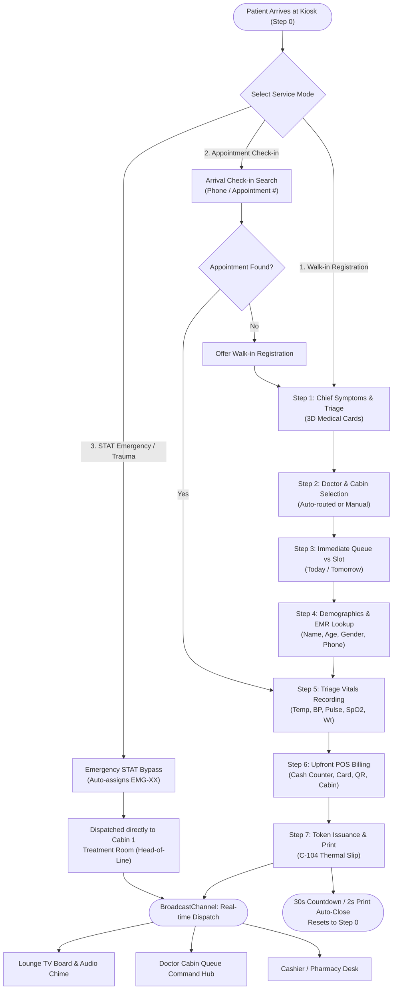

# 📱 Patient Self-Service Touch Kiosk — System Workflow & Architecture

> **Component Reference**: [`PatientKiosk.jsx`](file:///C:/Users/Hp/.gemini/antigravity/scratch/clinic-care-app/src/components/kiosk/PatientKiosk.jsx)  
> **Module Key**: `kiosk` / Role: `PATIENT_KIOSK`  
> **Target Hardware**: Touchscreen tablets (10"–15"), self-standing kiosk terminals, all-in-one touch PCs.

---

## 1. Architectural Overview & Design Philosophy

The **Patient Self-Service Kiosk** serves as the autonomous front door of the clinic. It is built to operate reliably in high-traffic outpatient environments with:
* **Dual Input Mode**: Automatically detects touchscreens (spawning custom on-screen Touch Numpads & Full Keyboards) or physical desktop hardware (autofocusing native inputs).
* **Crash-Resilience & Auto-Draft**: Periodically saves intake draft state to `sessionStorage` (`CLINIC_KIOSK_INTAKE_DRAFT`), offering instant session recovery if a patient or power cycle interrupts the flow.
* **Hardware Device PIN Lock**: 4-to-6 digit PIN security prevents unauthorized tampering, automatically locking the terminal after 5 minutes of inactivity (`useIdleTimer`).
* **Sub-5ms Synchronization**: Upon token creation, dispatches live queue updates to `CabinQueueDisplay` and `DoctorCabinConsole` via the browser `BroadcastChannel` API.

---

## 2. High-Level System Flowchart



---

## 3. The Three Primary Patient Pathways

### Pathway A: Standard Walk-In Patient Registration
The primary path for walk-in outpatient consultations:
1. Patient taps **"Register as Walk-in Patient"** on the Welcome screen.
2. Selects chief symptoms from 12 interactive 3D medical cards.
3. System pre-selects the recommended doctor cabin (or patient chooses).
4. Chooses immediate walk-in queueing.
5. Enters patient demographic details (Name, Age, Gender, Mobile Phone).
6. Records baseline clinical triage vitals (Body temperature mandatory; BP, Pulse, SpO2 optional/deferred).
7. Chooses payment settlement (Cash at Counter, Card, Touch QR, or Pay in Doctor's Cabin).
8. Receives thermal token slip (`C-104`) with estimated wait time and audio chime confirmation.

### Pathway B: Pre-Booked Appointment Arrival Check-In
Designed for patients who already booked online or over the phone:
1. Patient taps **"Appointment Check-in"** (`currentStep: 'CHECKIN_SEARCH'`).
2. Enters their mobile number via the touch numpad or hardware keyboard.
3. System performs instant lookup in `appointments` state:
   - Matches scheduled appointments for `Today`.
   - Displays doctor name, department, scheduled slot time, and overdue status.
4. Patient taps their appointment card to confirm arrival.
5. Advances directly to **Step 5 (Vitals Intake)** to capture arrival vitals.
6. Completes fee collection in **Step 6**.
7. Issues checked-in token (`APT-801` / `C-104`), updating appointment status to `CHECKED_IN`.

### Pathway C: STAT Emergency & Trauma Fast-Track
Engineered for urgent acute clinical distress (severe chest pain, breathing difficulty, acute trauma):
1. Patient or attending relative taps **"Emergency / Trauma Fast-Track"** on Step 0.
2. Bypasses standard questionnaires and fee collection immediately.
3. Generates high-priority `EMG-01` token.
4. Places patient at the **head of the line** for **Cabin 1 (Treatment Room)**.
5. Triggers flashing red visual alert on the TV Lounge display and doctor workstation.

---

## 4. Detailed Step-by-Step State Machine

### Step 0: Welcome / Attract Screen
* **Visual Presentation**: Clinic branding, real-time digital clock, active facility status, and estimated general queue wait time.
* **Draft Recovery Banner**: If `CLINIC_KIOSK_INTAKE_DRAFT` exists in `sessionStorage`, renders a **"Resume Incomplete Intake"** banner allowing returning patients to pick up where they left off.
* **Navigation Choices**:
  - `Register as Walk-in Patient` → Transitions to `currentStep: 1`.
  - `Appointment Check-in` → Transitions to `currentStep: 'CHECKIN_SEARCH'`.
  - `Emergency / Trauma Care` → Activates STAT emergency bypass.

---

### Step 1: Specialty & Chief Symptoms Triage Checklist
* **3D Visual Cards**: 12 categorized cards with energetic medical illustrations:
  - *Heart & Palpitations* → Pre-routes to Cardiology (Cabin 1).
  - *Shortness of Breath* → Pre-routes to Cardiology / Medicine (Cabin 1).
  - *Skin Rash & Itching* / *Acne & Lesions* → Pre-routes to Dermatology (Cabin 2).
  - *Knee, Joint & Back Pain* / *Sports Sprains* → Pre-routes to Orthopedics (Cabin 3).
  - *Childhood Illness* / *Infant Checkup* → Pre-routes to Pediatrics (Cabin 4).
  - *Blood Sugar Check* / *Chronic Wellness* → Pre-routes to Internal Medicine (Cabin 5).
* **Department Filter Chips**: Instant filtering by `Cardiology`, `Dermatology`, `Orthopedics`, `Pediatrics`, `Internal Medicine`.
* **Selection Logic**: Patients can select one or multiple symptoms; tapping **"Add for Next Step"** advances to Step 2.

---

### Step 2: Doctor & Specialist Cabin Selection
* **Doctor Profile Cards**: Displays attending specialist's full title, qualifications (e.g. *MD, FACP*), years of experience, patient rating (e.g. *4.9 ★*), consultation fee (`Rs. 50`), and real-time cabin status:
  - `AVAILABLE` (Green)
  - `IN_CONSULTATION` (Blue)
  - `ON_BREAK` (Amber)
* **Smart Pre-Selection**: The cabin recommended by Step 1 is automatically pre-highlighted, though patients can override and select any available doctor.

---

### Step 3: Intake Type: Immediate Walk-in vs Pre-booked Slot
* **Booking Type Toggle**:
  - `WALK_IN`: Enters active queue immediately upon token printing.
  - `SLOT`: Selects a scheduled appointment time slot for `Today` or `Tomorrow`.
* **Smart Future Slot Filter (`isSlotInFuture`)**: Automatically disables past time slots for the current day to eliminate scheduling errors.

---

### Step 4: Patient Demographics & Profile Identification
* **Fields Captured**:
  - `patientName`: Validates minimum 2 characters.
  - `age`: Validates realistic age (1 to 125).
  - `gender`: Radio chips for `Male`, `Female`, `Other`.
  - `phone`: Mobile number (minimum 5 digits).
* **Dual Input Interface**:
  - Touch Numpad for Phone and Age.
  - On-screen QWERTY Touch Keyboard with caps lock, space, backspace, and clear.
  - Physical hardware keyboard auto-focused for fast typing on desktop kiosks.
* **Instant EMR History Lookup**: As phone digits are entered, queries `searchPatientHistoryByPhone()`. If a returning patient is matched, a green badge displays returning visit count, allergies, and chronic conditions.

---

### Step 5: Clinical Vitals Recording & Triage
* **4-Screen Guided Triage Flow**:
  1. **Body Temperature (°F)**: Mandatory clinical triage check (default: `98.6°F`, adjustable with 1-tap `+0.2` / `-0.2` buttons).
  2. **Blood Pressure (mmHg)**: Captures Systolic / Diastolic values. Can be explicitly marked or "Deferred to Doctor Cabin".
  3. **Heart Pulse (bpm)**: Normal range `60–100 bpm`. Can be recorded or deferred.
  4. **Oxygen Saturation SpO2 (%)**: Normal `95%–100%`. Critical values (<92%) trigger emergency triage warnings.
  5. **Weight (kg)**: Quick tap adjustment.
* **Clinical Safety Validation**: Temperature must be confirmed before advancing to billing.

---

### Step 6: Upfront Billing & Payment Settlement
* **Payment Methods**:
  - `CASH`: Cash at Counter / Cashier.
  - `CARD`: EMV Card Terminal swipe.
  - `TOUCH_PAY_UPI`: Instant dynamic QR payment.
  - `PAY_IN_CABIN`: Consultation fee deferred to be paid directly inside the doctor's cabin.
* **POS Touch Keypad Calculator**:
  - Keypad buttons for entering cash tendered (`Rs. 100`, `Rs. 500`, `Rs. 1000`, `Rs. 5000`).
  - Real-time **Change Due** calculation (`cashTendered - netPayable`).
  - Validation blocking token generation if cash tendered is less than net payable.
  - Insurance co-pay and clinic discount inputs.

---

### Step 7: Token Issuance & Thermal / Laser Printing
* **Token Allocation**:
  - Sequential cabin token generation (e.g. `C-104`).
  - Invoice generation (e.g. `APEX-INV-C-104`) with status `PAID_UPFRONT` or `PAY_IN_CABIN`.
* **Wait Time Estimation (`getEstimatedWaitTime`)**: Computes expected consultation time based on waiting queue count and active doctor throughput.
* **Print Slips**:
  - **Queue Token Thermal Slip Modal**: 80mm / 58mm compact POS ticket showing Token, Cabin #, Doctor Name, Date/Time, and QR code (ZERO billing amounts printed for privacy).
  - **Laser Medical Invoice**: Itemized A4/A5 laser invoice showing consultation fee, deductions, payment method, and cashier stamp.
  - **2-Second Auto-Close**: Closes print preview 2 seconds after triggering print or download.
* **Automatic Inactivity Reset**: A 30-second countdown automatically clears state, purges session draft, and resets the kiosk to Step 0 for the next patient.

---

## 5. Security & Device Protection Features

| Security Feature | Implementation | Description |
| :--- | :--- | :--- |
| **Device PIN Lock** | `kioskLockState` & `unlockKiosk(pin)` | 4-to-6 digit master PIN required to access kiosk settings or unlock device. |
| **Inactivity Auto-Lock** | `useIdleTimer` (default 300s / 5 min) | Terminal automatically locks itself if left unattended by staff. |
| **Brute-Force Lockout** | `lockoutUntil` state | 3 failed PIN attempts triggers a 60-second cooldown period. |
| **Clinic Suspension Gate** | `isCurrentClinicLocked` | If Super Admin suspends the clinic, kiosk renders a full-screen lockdown shield displaying the suspension notice. |
| **Physical Key Binding** | `handlePinKey` / `handlePaymentKey` | Supports physical USB numpads and barcode/RFID scanners alongside touchscreen taps. |

---

## 6. Real-Time Multi-Station Data Synchronization

When a patient completes intake at the Kiosk, the following updates occur instantaneously across the system:

```
[Patient Kiosk Token Generated]
        │
        ├──► ClinicContext State Update: newPatient added to `patients`, newInvoice to `invoices`
        │
        ├──► BroadcastChannel ("apex_clinic_bus") dispatches `{ type: 'CLINIC_STATE_UPDATE' }`
        │
        ├──► CabinQueueDisplay (Lounge TV):
        │       - Token appears in active waiting list
        │       - If emergency: triggers red spotlight banner
        │
        ├──► DoctorCabinConsole:
        │       - Next-patient hero card updates with token, symptoms, vitals & payment status
        │       - KPI dashboard increments waiting queue counter
        │
        └──► BillingPharmacyPOS:
                - Invoice registered in front-desk cashier accounts
```
